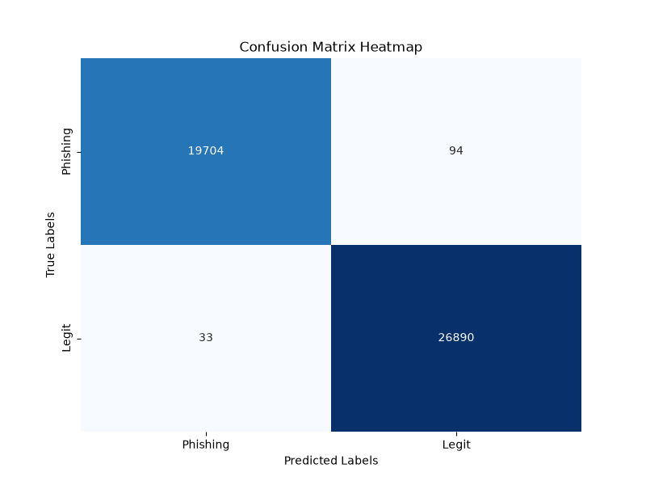

# Gone Phishing - The perfect phishing protection

## 1. Background
Phishing is a type of cyberattack where a victim receives a malicious email, text message phone call or website link. The goal of phishing attacks are often to exfiltrate sensitive data or trick the victim into executing or downloading malware. This project aims to develop a protection against URL based phishing attacks. These are attacks where the victim is sent or finds a link that will in some way exploit them, if they click on it. Such links are often sent by email, which is why it is common for cybersecurity training to instruct people not to click on links sent from suspicious sources.

## 2. Problem statement
One way to detect URL phishing is by examining the link. Since phishing is illegal the domains are usually suspicious and contain uncommon top-level domains or dangerous extensions. Our project uses machine learning to identify such phishing links. This was done by finding open datasets of regular and phishing links and training a model on them. This model can therefore be used to check suspicious links to see if they are likely to be phishing attempts. It could potentially be used with a proxy web extension to intercept traffic to potential phishing links and warn the user that the link they have clicked on is suspicious.

### 2.1 Scope
We will limit the scope to using ML to identify URLs as either malicious or safe even though there are other methods of examining URLs. For example the tool CheckPhish looks at the DNS data, redirects, ip addresses, location of the provider, gives a screenshot of the website and more, along with a verdict about the site's security. These features are useful to determine the legitimacy of a URL. However for this project we limit our scope to using ML and only looking at the URL itself.

## 3. Method
### 3.1 Machine Learning Models
After testing a few model families we chose to use the Random Forest model. The reason is that in our initial testing Random Forrest outperformed the other tested models. The three models we tested were Random Forest, Gradient Boosting and Logistic Regression and Gradient boosting also performed well. Gradient boosting also performed well even though it was outperformed by Random Forest. On the other hand Logistic Regression performed relatively poorly compared to the other models. Therefore we chose Random Forest
### 3.2 Databases
The databases we used are the LegitPhish Database and PhiUSIIL. Both are open databases, but PhiUSIILis significantly larger than LegitPhish . Our strategy was to decide which machine learning model we should use based on the models performance on the OpenPhish database. In order to take that model and fine tune it on the larger Phishtank database.

According to common Machine Learning praxis the databases were split so that 80% of the data was training data and 20% testing data. So the finished model can be tested on data it has not seen.

### 3.3 Features
The model is trained based on the following features (in order of importance):

| Feature               | Description   |
| ---                   | ---           |
| IsHTTPS               | Binary flag (1) if HTTPS (0) otherwise. HTTPS encrypts the traffic between the user and the server. Most legit websites use HTTPS, but it is not a guarantee that a phishing site does not.
| NoOfDegitsInURL |Number of digits (0-9) in the URL. Phishing URLs often use a large amount of numbers for typosquatting in order to confuse the user. (e.g. amazon -> amaz0n).
| DegitRatioInURL | The ratio of the number of digits to the total length of the URL. Higher ratio would suggest a higher probability of typosquatting, or automatically generated URLs.
| LetterRatioInURL | The ratio of letters in comparison to the total length of the URL.
| NoOfLettersInURL | The number of alphabetic characters in the URL.
| DomainLength | The length of the domain including subdomains and the Top Level Domain (TLD). Phishing websites usually have a larger domain length to imitate legitimate services. (e.g. mybank.se -> transfer-mybansk.se) or subdomain takeover.
| NoOfSubDomain |The number of subdomains in the URL. 
| TLDLength | The length of the Top Level Domain (TLD) 
| NoOfQMarkInURL |Number of question marks in the URL, used to detect the existence of parameters. 
| NoOfEqualsInURL | Number of equal signs in the URL, also used for parameter detection.
NoOfOtherSpecialCharsInURL | Counts the number of non alphanumeric characters. Higher numbers could indicate embedded HTML tags or javascript code. 
SpacialCharRatioInURL | Ratio of special characters to url length.
NoOfAmpersandInURL | Number of equal signs, also used for parameter detection.
NoOfObfuscatedChar |Number of percentage signs (%), meant to detect possible URL encoding to hide malicious code or parameters. 
IsDomainIP | Binary flag (1) if IP address or (0) otherwise. 
ObfuscationRatio | Ratio of percentage characters to the URL length.
HasObfuscation | Binary flag: (1) if at least one percentage character is detected, (0) otherwise. 

### 3.4 Requirements

The following dependencies on external libraries are needed to run the project:

- pandas==3.0.6
- joblib==1.6.0
- seaborn==0.13.2
- scikit-learn==1.9.1
- matplotlib==3.11.2
- numpy==2.4.6
## 4 Results and Discussion
Our resulting Random Forest model performed well on the testing data from the PhiUSIIL database. The confusion matrix below shows that out of the 26923 legit URLs in the data set only 25 were classified as phishing and of the 19798 phishing URLs only 89 were classified as legit. This means that our model was performant with a small error rate. 


For context this means that if you check a malicious URL the predicted probability that it passes our filter as a legitimate URL is 0.45%. However this could be a problem if our solution is implemented at scale since we should expect some links to get through.

There are also some edge cases and types of phishing links which our model is bad at identifying. For example our model detects https://www.amaz0n.com as a legit link since numbers in URL are not inherently suspicious like in 1177.se and our model does not know that amaz0n is close to the legit domain amazon. 

Additionally, using non ascii characters ( for example using the cyrillic a instead of the latin character in https://www.amazon.com) is not detected by our model. 

Therefore our model is weak to the exploits called typosquatting and punycode. An attacker could take advantage of the above to bypass our model, by registering domains using typosquatting. 

To defend against these exploits we would need to implement some lookup checks. Similar to the ones used by CheckPhish. Where we could look up the information about the host of the URL and search a database for common domains for similar domains. So that amaz0n.com could be identified as suspicious because of the similarity to amazon.com.

It is worth noting for the scope of this project, features using levenshtein distance to well known websites were considered, but were not implemented due to limitations of computing power.

## 5 How to run the project:

1. Clone the project:
    ```
    git clone git@github.com:cristibercea/gone_phishing.git
    ```
2. Install requierments:
    ```
    pip install -r requierments.txt
    ```
3. Start the cli using python:
    ```
    python3 main.py
    ```
4. Train the model:
    ```
    train
    train <path-to-dataset>
    back
    ```
5. Predict for a url:
    ```
    predict
    predict <url>
    ```
6. Exit the program using the exit command.


## 6 References

- https://www.ibm.com/think/topics/phishing
- https://www.sciencedirect.com/science/article/pii/S2352340925006961
- https://archive.ics.uci.edu/dataset/967/phiusiil+phishing+url+dataset
- https://checkphish.bolster.ai/
- https://www.geeksforgeeks.org/random-forest-classifier-using-scikit-learn/
